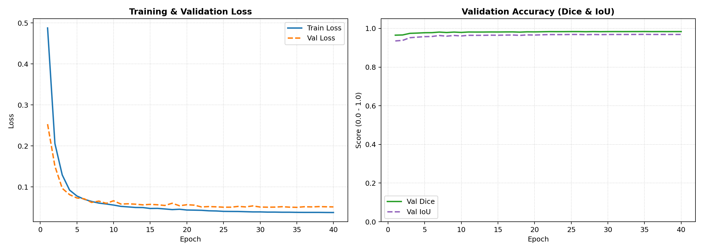
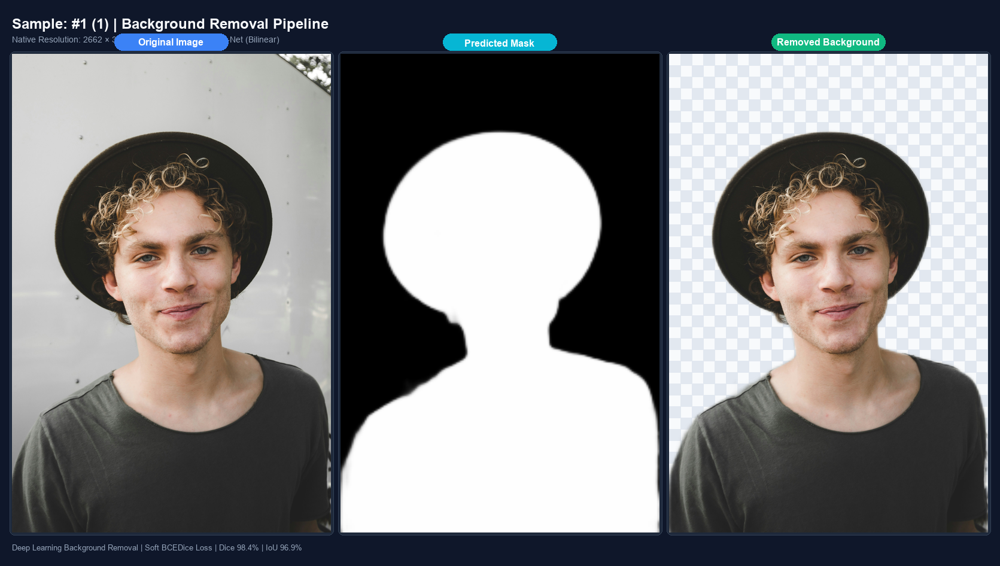
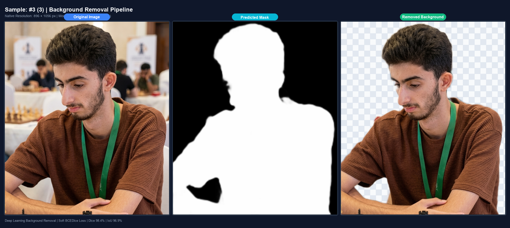

# Deep Learning Background Removal (ResNet-34 U-Net)

A streamlined, production-grade deep learning background removal system specialized for human portraits and objects. Built with a U-Net architecture featuring a pretrained ResNet-34 backbone and an artifact-free bilinear decoder.

---

## Key Highlights

- **Pretrained Backbone**: ResNet-34 ImageNet feature extractor with warmup freezing.
- **Smooth Bilinear Decoder**: Replaces transposed convolutions with bilinear upsampling + conv to eliminate checkerboard edge artifacts on hair and body boundaries.
- **Loss & Metrics**: Soft Dice Loss + Binary Cross Entropy (`BCEDiceLoss`), evaluated with Dice score and IoU.
- **Multi-GPU Ready**: Automatically detects multiple GPUs (e.g. 2x T4 on Kaggle) and enables `torch.nn.DataParallel`.
- **Flat & Clean Codebase**: No complex YAML parsers, no deep folder nesting. Every file is self-contained and easy to read.

---

## Clean Project Structure

```
├── config.py         # All hyperparameters and paths in one clean Python class
├── dataset.py        # Paired image + mask/matte dataset loader with augmentations
├── model.py          # Unified U-Net architecture (ResNet-34 + Bilinear Decoder)
├── loss.py           # Combined BCEDiceLoss and Dice/IoU evaluation metrics
├── train.py          # Training loop with Multi-GPU, CosineAnnealingLR, and early stopping
├── predict.py        # Inference pipeline (transparent PNGs, solid backgrounds)
├── plot.py           # Script to plot Loss, Dice, and IoU curves from history.csv
├── notebook.ipynb    # End-to-end Kaggle training & inference walkthrough
├── requirements.txt  # Python package dependencies
└── README.md         # Documentation
```

---

## Installation

```bash
git clone https://github.com/Razamindset/bg-removal-with-deep-learning.git
cd bg-removal-with-deep-learning
pip install -r requirements.txt
```

---

## Quick Start

### 1. Training on Kaggle (Recommended)
Open and run [`notebook.ipynb`](notebook.ipynb) on Kaggle:
- Supports 2x T4 GPUs out of the box with `nn.DataParallel`.
- Set dataset path in `config.py` (e.g., `/kaggle/input/p3m-10k`).
- Automatically handles asset caching, training, curve plotting, sample visual cutouts, and artifact compression.

### 2. Training Locally
```bash
python train.py
```
- Automatically uses GPU if available, or CPU.
- Checkpoints are saved to `outputs/best_model.pth` and `outputs/last_model.pth`.
- History is logged to `outputs/history.csv`.

### 3. Plot Training Curves
```bash
python plot.py --csv outputs/history.csv --out outputs/curves.png
```

### 4. Profile Training Speed
Run a short timing pass before full training to find the bottleneck:
```bash
python profile_train.py --train-batches 50 --val-batches 10 --batch-size 64 --num-workers 2
```

Compare against one GPU if `nn.DataParallel` looks suspicious:
```bash
python profile_train.py --train-batches 50 --batch-size 64 --single-gpu
```

The report breaks batch time into data loading, CPU-to-GPU transfer, forward, loss, backward, and optimizer stages.

### 5. Background Removal Inference

#### Extract Transparent RGBA Cutout (Default):
```bash
python predict.py --weights outputs/best_model.pth --input path/to/image.jpg --output outputs/predictions
```

#### Process an Entire Folder:
```bash
python predict.py --weights outputs/best_model.pth --input path/to/folder --output outputs/predictions
```

#### Replace Background with Studio White:
```bash
python predict.py --weights outputs/best_model.pth --input path/to/image.jpg --bg-color 255 255 255
```

---

## Configuration

All settings can be customized in [`config.py`](config.py):
```python
from config import cfg

cfg.data_dir = "/kaggle/input/p3m-10k"   # Path to images and masks
cfg.image_size = 256                    # Input resolution
cfg.batch_size = 16                     # Batch size per step
cfg.epochs = 40                         # Total training epochs
cfg.lr = 1e-3                           # Decoder learning rate
cfg.encoder_lr = 1e-4                   # Pretrained backbone learning rate
cfg.freeze_epochs = 2                   # Backbone warmup freeze epochs
```

---

## Experimental Results & Benchmark

The model was trained for 40 epochs on the **P3M-10k** dataset with a ResNet-34 backbone pretrained on ImageNet and a custom artifact-free bilinear decoder using Cosine Annealing learning rate schedule.

### 1. Quantitative Performance

| Metric | Initial (Epoch 1) | Best Model (Epoch 35) | Final (Epoch 40) |
|---|---|---|---|
| **Validation Dice Score** | 0.9650 | **0.9839** | 0.9836 |
| **Validation IoU (Jaccard)** | 0.9352 | **0.9692** | 0.9687 |
| **Validation Loss (BCEDice)**| 0.2532 | **0.0502** | 0.0513 |
| **Training Loss** | 0.4878 | **0.0380** | 0.0376 |

> **Key takeaway:** The model converges steadily without overfitting. The validation Dice score reaches **98.39%** and validation IoU reaches **96.92%**, showing crisp boundary detection on challenging subjects.

---

### 2. Training Dynamics & Convergence

Training and validation loss along with Dice and IoU metrics over 40 epochs:

<p align="center">
  
</p>

- **Loss Curves (Left):** Smooth convergence with learning rate decay from $10^{-3}$ down to $10^{-6}$.
- **Dice & IoU Curves (Middle & Right):** Rapid rise during early epochs, stabilizing above $0.98$ Dice and $0.96$ IoU.

---

### 3. Visual Results & Showcase

A side-by-side comparison across portrait test images (Original Image vs. Predicted Mask vs. Clean Cutout):

<p align="center">
  
</p>

<p align="center">
  
</p>

#### Complete Portfolio Showcase:
- **Comprehensive Showcase PDF:** [`assets/background_removal_showcase.pdf`](assets/background_removal_showcase.pdf) — Includes full model architecture details, training curve analysis, and 8 diverse case studies (portraits, complex hairstyles, varied lighting, solid backgrounds).


